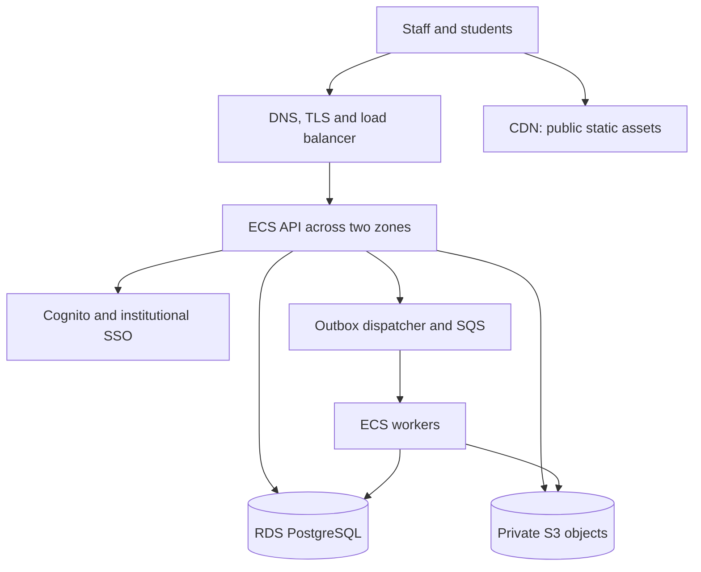

# Course Pilot — technical architecture and hosting blueprint

Version 1.0 · 16 November 2026 · Chief engineering recommendation  
Status: proposed target architecture; no infrastructure provisioned.

## 1. Executive decision

Build Course Pilot as a TypeScript SaaS application with a modular API, independently scalable background workers and PostgreSQL. Host the first commercial deployment in AWS Sydney (ap-southeast-2). Reuse the current deterministic JavaScript recommendation engine and migrate it incrementally to typed interfaces.

Use shared infrastructure with enforced logical institution isolation for the standard subscription. Offer a dedicated PostgreSQL instance and, where contracted, dedicated application infrastructure for institutions requiring stronger isolation. Keep one product codebase and versioned institution configuration across both tiers.

This document accompanies Course_Pilot_Product_Features_v2.md and Course_Pilot_Recommendation_Engine_Rules.md, both version 2.2. It supersedes the stack and hosting recommendations in docs/RUNTIME_ARCHITECTURE.md dated 3 November. Product rules remain governed by the rules specification.

### Evidence and assumptions

The reviewed runtime is sites/coursepilot-runtime/.sites-checkout at f88e586. It uses TypeScript HTTP routing, JavaScript domain modules, a browser UI, Cloudflare D1 and R2. D1 holds one revision pointer to an immutable compressed aggregate state object in R2. The earlier Python/SQLite runtime is a legacy baseline.

The current outer ChatGPT identity check does not establish institution membership and course permissions for the selected coordinator profile. Profile selection must become a selection among verified memberships. Existing course scoping is useful groundwork, but commercial tenant isolation is still to be implemented.

Planning assumptions for initial sizing: 1–5 institutions, up to 10,000 active students in total, 100 concurrent staff users and bursty intake imports. These are engineering test assumptions, not measured capacity or customer commitments. Student self-service growth requires a separate traffic test.

## 2. Technology decisions

| Layer | Recommendation | Reason and implementation direction |
| --- | --- | --- |
| Language | TypeScript on a supported Node.js LTS release | Reuse the working JS engine, share API types, improve maintainability without changing academic outcomes. Pin supported versions during implementation. |
| Web UI | React, TypeScript and Vite | Authenticated operational application with no material SEO dependency. Incrementally replace the large imperative UI with journey-based components. |
| API | Fastify modular monolith, REST and OpenAPI | Small operational footprint, clear domain modules and validated contracts. One API deployable initially. |
| Validation | Zod at external boundaries | Validate imports, configuration, commands and API responses independently of compile-time types. |
| Data | Managed PostgreSQL; Drizzle plus reviewed SQL migrations | Transactions, relational constraints, history and row-level security. Explicit SQL for isolation policies. |
| Engine | Versioned deterministic JS/TS package | Preserve evidence, reproducibility and tested rules. Future language changes require measured benefit and equivalence tests. |
| Background work | Node.js workers on ECS with SQS | Imports, calculations and PDF exports scale independently from interactive traffic. |
| Files | S3 private objects | Accepted uploads, staged files and approved exports with ownership and retention metadata. |
| Identity | Cognito with institutional OIDC/SAML federation | MFA and institutional sign-in. Application database remains authoritative for memberships and effective course assignments. |
| Infrastructure | Terraform, Docker, GitHub Actions using AWS OIDC | Reproducible environments, reviewed changes and short-lived deployment credentials. |
| Quality | Existing engine tests, API integration tests, Playwright and k6 | Academic parity, isolation, coordinator journeys and load behaviour. |
| Observability | OpenTelemetry instrumentation and CloudWatch | Correlate requests, jobs, releases and tenant operational health. |

Use one repository with apps/web, apps/api, apps/worker and packages/domain, engine, contracts and database. Enforce module boundaries in CI. Kubernetes, Kafka, a distributed microservice estate and an LLM decision engine are unnecessary for the initial workload.

Midnight navy and muted indigo remain the UI palette. Action needed, Waiting, On track and Completed remain the coordinator-facing task states; technical job states stay in administrative views.

## 3. Product and domain boundaries

| Module | Responsibilities | Principal records |
| --- | --- | --- |
| Platform administration | Provisioning, subscription entitlements, tenant placement and service health | Institution, subscription, entitlement, placement, onboarding job |
| Identity and authority | Membership, dated assignments, delegation and support grants | User, membership, role binding, course assignment, access grant |
| Academic catalogue | Versioned course requirements and prerequisites | Course, curriculum version, subject, rule configuration |
| Intake planning | Interest, participation, scenarios, offerings and confirmation | Teaching period, course intake, preference, participation override, plan, confirmation |
| Timetabling and staffing | Draft/publish, sessions, groups and teaching allocation | Offering, class group, session, lecturer availability, allocation |
| Intake operations | Actual enrolment, assessment, extension, attendance and timesheet approvals | Enrolment, assessment, submission, extension, attendance, timesheet |
| Completion and graduation | Academic evidence, coordinator approval, administrative clearance, ceremony | Completion assessment, approval, clearance, ceremony roster |
| Data and recommendations | Staging, source reconciliation, rules execution and freshness | Import batch, source row, delta, snapshot, engine run, finding |
| Work management and audit | Action ownership, reasons, evidence and history | Task, decision, audit event, notification |

A course intake links a course to a teaching period. Curriculum version is bound to the student's course enrolment rather than inferred from today's catalogue. Students may have multiple course enrolments. Counts distinguish people, course enrolments and subject registrations.

Every institutional entity carries institution_id. References between institutional entities use composite tenant-and-record constraints. Student source IDs are unique within institution and source system; identical external IDs across institutions are valid.

Store session timezone, date range, recurrence and exceptions explicitly. The future clash checker must compare actual occurrences, including daylight-saving changes, while preserving the current documented engine behaviour until the replacement is validated.

Lecturer and student clash checks span all relevant courses and simultaneous intakes within the institution. Return a conflict indication without revealing another course's restricted student details. Cross-institution lecturer availability requires an explicitly authorised shared-calendar mechanism; institutions must not gain access to each other's rosters.

## 4. Tenant isolation and access

### Isolation offering

| Model | Use | Trade-off |
| --- | --- | --- |
| Shared database with tenant rows and forced RLS | Default commercial tier | Efficient fleet operations; logical isolation shares database capacity and failure domain. |
| Separate database on a shared instance | Optional intermediate placement | Separate database credentials and namespace; still shares infrastructure and instance recovery. |
| Dedicated RDS instance per institution | Enterprise isolation tier | Independent capacity, backup and maintenance controls; higher recurring cost. |
| Dedicated account and application deployment | Contract-driven enterprise tier | Stronger operational boundary; highest provisioning and support overhead. |

Avoid schema-per-institution as the default because it adds migration and search-path complexity without providing a dedicated infrastructure boundary.

A platform placement registry maps institution to region, deployment cell and database target. Resolve it on the server. Reuse the same schema and migrations in each placement. A cell is a bounded group of tenants sharing an API/worker/database deployment; introduce additional cells as measured load or contractual isolation warrants.

### Enforcement contract

1. Validate the authenticated session, then resolve active membership and role from trusted application records. Institution selection is checked against that membership on every request.
2. Apply course assignments and effective dates in domain authorization. An institution boundary alone does not authorise every coordinator to access all courses.
3. Open a database transaction and set tenant context transaction-locally using a parameterised call. Execute all scoped operations on that transaction connection; missing context fails closed.
4. Enable and force PostgreSQL row-level security on institutional tables. Policies constrain both visibility and writes. Runtime roles are non-owner, non-superuser and lack BYPASSRLS, schema alteration and TRUNCATE privileges. Separate migration credentials never run the application.
5. Include tenant keys in foreign keys, uniqueness, indexes, pagination cursors, job records, cache keys and object metadata. UUIDs are identifiers, not access controls.
6. Authorise exports and object downloads before generating short-lived signed URLs. Use private tenant prefixes plus scoped storage permissions; a prefix alone is insufficient.
7. Workers receive tenant, scope and snapshot IDs, validate the job against stored records, and establish their own tenant context. Recheck current authority before executing a delayed privileged mutation.
8. Tenant suspension revokes routine access and pauses its mutable jobs. Revocation is checked server-side rather than relying solely on long-lived token claims.

PostgreSQL documents owner and privileged-role bypass behaviour, making deployment credentials and policy tests essential [S1]. RLS protects against missing query predicates; it cannot compensate for a fully compromised privileged application or database administrator.

Use secure HttpOnly session cookies, CSRF protection on state changes, short-lived sessions and MFA for privileged roles. Support multiple tenant memberships per person. Do not use email domain alone as proof of membership. Cognito supports several tenant arrangements; start with shared authentication plus explicit application membership, and isolate identity pools where contractual requirements demand it [S2].

### Required isolation tests

Create two institutions with deliberately overlapping course and student identifiers. Attempt cross-tenant reads, writes, joins, bulk operations, exports, downloads, guessed URLs, background jobs and support actions. Test missing tenant context, reused pooled connections, expired assignments, revoked membership and cache collisions. Run these tests with real PostgreSQL and the production-equivalent runtime role.

## 5. Data refresh and recommendation execution

Upload → quarantine and parse → stage deltas → review/accept → immutable input snapshot → queued calculation → validated publication.

Acceptance commits canonical changes and an outbox event in one transaction. An outbox dispatcher sends SQS messages; duplicate delivery is expected. Workers use idempotency keys and durable job leases. Acknowledgement follows committed results, with retry backoff, visibility renewal, capped attempts and a dead-letter queue.

A run records institution, course intake, input snapshot, curriculum and rule versions, timetable version, engine build, initiator and timestamps. Results become current only when the relevant accepted versions still match. Older results remain available as history and cannot silently replace fresh results.

Partition work by institution and course intake, and by student where safe. Apply per-tenant concurrency and upload limits to prevent one large import exhausting shared capacity. Use batch checkpoints and bounded scenarios; retain the documented pending-result enumeration limits. Expose freshness and failed-refresh warnings to coordinators while continuing to serve the last accepted results.

Local enrolment confirmation remains an immutable snapshot of selected expected plans with provisional assumptions. Later marks, timetable changes or rules create reconciliation tasks; they must not silently rewrite confirmed enrolment. Source-confirmed enrolment remains a separate authoritative observation. Implement an explicit amendment workflow with a new version and audit evidence.

Publish timetables, accept imports and approve decisions using optimistic version checks. Revalidate conflicts and prerequisites at commit. Reject stale decisions with a clear refresh action. Distinct decisions create distinct tasks; repeated engine findings update existing task evidence instead of flooding the coordinator queue.

An LLM may later explain findings using approved evidence. Academic eligibility, completion, course limits and timetable checks remain deterministic and independently testable.

## 6. Institution setup and commercial administration

Global Admin uses a guided onboarding workflow:

1. Create institution, region, isolation tier, contract dates and subscription entitlements.
2. Assign an institution admin and configure identity federation, branding, timezone and support policy.
3. Import courses, versioned curricula, teaching periods and source mappings.
4. Assign coordinators and lecturers with effective dates and scopes.
5. Run a sample import, inspect errors and reconcile student and subject counts.
6. Run recommendations in preview and review evidence against institution-approved examples.
7. Activate the tenant and monitor its first live refresh.

Provisioning is resumable and idempotent. Persist each completed step so a retry cannot duplicate databases, users or initial imports. Activation requires successful isolation and data reconciliation checks.

Configuration is schema-validated, versioned and effective-dated. Include load limits, summer policy, prerequisites, grading mappings, source semantics, assessment/attendance thresholds, retention, notification templates and feature entitlements. Preview changes against a representative cohort before activation. A rollback publishes a new configuration version and triggers appropriate recalculation.

Global Admin sees operational metadata by default. Student-data support access requires the explicit logged grant defined in the product specification. Grants specify tenant, scope, permitted actions, reason and expiry; read-only is the default. Display an obvious support-session banner and record both operator and effective role. No silent impersonation.

Subscription entitlements are enforced on the server. Record usage for commercial reporting, with institution counts, active students, storage and job consumption. Choose billing currency, invoicing provider and overage policy after pricing strategy is agreed; financial status must never silently delete academic records.

Offboarding includes an authorised export, revoked access, stopped jobs and staged deletion under the agreed retention policy. Backups expire on their retention schedule and restored data must have deletion instructions reapplied.

## 7. Recommended hosting platform

### AWS Sydney baseline

Use separate AWS accounts for production and non-production, plus central audit/security administration as the team grows. Keep databases, workers, source objects and operational logs in Sydney by default. Verify identity, CDN, support access, backups and subprocessors before making an Australian-residency commitment.

| Service | Launch configuration | Operational responsibility |
| --- | --- | --- |
| Route 53 and ACM | Product domain, DNS and TLS | Certificate and domain ownership monitoring |
| CloudFront + S3 | Static application assets | Never cache authenticated student responses in shared public caches |
| ALB + AWS WAF | HTTPS ingress and abuse controls | Health checks, rate limits and controlled origin access |
| ECS Fargate API | Two tasks across two zones; initial 0.5 vCPU/1 GiB each | Scale on measured CPU, latency and load; minimum two for rolling releases |
| ECS Fargate worker | Initial 1 vCPU/2 GiB; concurrency bounded | Scale on queue age and workload; benchmark XLSX/PDF peaks |
| RDS PostgreSQL | Multi-AZ DB instance, initial 2 vCPU/8 GiB class, 100 GiB storage | Validate class/region support and load; monitor connections and I/O |
| S3 + KMS | Private versioned buckets and lifecycle policies | Tenant authorisation, retention, encryption and recoverability |
| SQS + DLQ | Import, recommendation and export job types | Idempotency, retry visibility, poison-job handling |
| Cognito | Regional user pool with institution federation | Authentication lifecycle and recovery; tenant permissions in application |
| CloudWatch and CloudTrail | Redacted logs, metrics, alarms and administrative audit | On-call ownership, retention and actionable alerts |
| Secrets Manager and ECR | Secrets and versioned container images | Rotation, vulnerability scanning and release traceability |

Sizing above is a starting benchmark configuration, not proven capacity. Use supported PostgreSQL and Node versions after compatibility testing. Set connection-pool budgets across all API/worker replicas below database limits. Add RDS Proxy only when measured connection churn justifies the cost.

Use private application subnets and an isolated database network. Restrict inbound paths to the load balancer and security-group-authorised database clients. For external identity or integration access, budget resilient outbound networking across zones. Compare NAT gateways against the full set of required VPC endpoints; include hourly and data-processing costs. Use S3 gateway endpoints where appropriate.

AWS operates the underlying managed services; Course Pilot remains responsible for schema changes, tenant permissions, backup verification, incident response and support coverage.

### Hosting alternatives

| Platform | Suitability | Decision |
| --- | --- | --- |
| AWS ECS Fargate + RDS | Commercial baseline with managed containers, regional data services and enterprise isolation options | Recommended default given Australian launch and operational requirements |
| Azure Container Apps + PostgreSQL Flexible Server | Strong alternative where customers or operating team standardise on Azure | Equivalent architecture using managed identities, Service Bus, Blob Storage and Azure monitoring; validate region/features separately |
| Current Cloudflare runtime | Useful current product delivery environment | Retain during migration; whole-state storage and profile identity require redesign before multi-institution launch |
| Single VM with containers | Small controlled evaluation | Lower infrastructure complexity but greater patching, failover and recovery responsibility |

Azure Container Apps supports revision-based rollout [S3]. The current Cloudflare D1 documentation lists EU, US and FedRAMP jurisdiction restrictions and explicitly says a location hint is not a location guarantee. Therefore an Oceania hint is insufficient evidence for an Australia-only contractual boundary [S4]. This finding concerns D1; separately assess R2, Workers and any replacement architecture.

## 8. Costs and capacity management

Create a dated AWS Pricing Calculator estimate for Sydney before provisioning. Current public pricing is usage- and configuration-dependent; this document does not present an unverified monthly quote.

Calculate 730 hours/month for each always-on component. Include:

| Cost driver | Estimate input |
| --- | --- |
| API compute | Two tasks × 0.5 vCPU and 1 GiB × 730 hours, plus scaling |
| Worker compute | One task × 1 vCPU and 2 GiB × operating hours; test autoscaling economics |
| Database | Chosen 2 vCPU/8 GiB class, Multi-AZ, 100 GiB, backup excess and storage growth |
| Networking | ALB hours/LCUs, NAT per zone or endpoints, IPv4 and data transfer |
| Storage | Source files, object versions, PDFs, requests and lifecycle transitions |
| Identity and security | Active users, federation, MFA delivery, WAF, KMS and secrets |
| Operations | Log ingestion/retention, metrics, audit, support plan and alarms |
| Non-production | Separate staging database, scheduled compute and test environments |
| Commercial extras | Email delivery, domain, engineering/on-call, GST and currency conversion |

Fargate bills requested compute resources and runtime; RDS and network services add separate charges [S5–S7]. Set budget alerts and track cost per institution and active student. Approve an actual estimate against subscription margins before a sales price is committed.

Pilot savings can include scheduled staging, limited log retention and one worker. A single-AZ database lowers cost but loses the proposed commercial availability baseline. Reserve capacity only after stable utilisation is measured.

Scale in this order: query/index optimisation, bounded jobs, API/worker scaling, database capacity, then additional tenant cells. Add read replicas for proven reporting pressure. Allocate dedicated resources when sustained per-tenant load or a contract warrants it.

## 9. Releases, support and recovery

### Release process

CI runs engine parity, real-database isolation, API contract and journey tests, followed by dependency/image scanning. Promote the same immutable image from staging to production using short-lived deployment credentials.

Apply expand-and-contract migrations: add compatible schema, deploy code, backfill in bounded batches, verify, and remove old schema in a later release. Limit migration lock waits and rehearse against representative data. Old and new workers must understand queued message versions during rollout.

Use rolling ECS releases with health checks, connection draining, sufficient spare capacity and rollback alarms. The ECS deployment circuit breaker supports failed-deployment rollback [S8]. Use tenant feature flags for staged capability activation. Code rollback is safe only while data/schema remain compatible.

Target uninterrupted ordinary releases; database failovers, destructive migrations and major upgrades can still interrupt requests. Schedule and communicate unavoidable maintenance. Retry safe operations and use idempotency keys for retried commands.

### Supportability

The operations console shows institution status, accepted data freshness, engine/configuration versions, queue age, failed imports, error rate and deployment health. Support can retry a specific idempotent job, pause a tenant queue, preview configuration or produce an audited diagnostic bundle without restarting everyone.

Separate student audit evidence from infrastructure logs. Redact source rows, credentials and personal details from telemetry. Correlation IDs link a support case to the request/job, with access restricted by operational role.

Maintain runbooks for failed refresh, stale calculations, lost identity access, publication conflicts, queue poison messages, database failover, tenant restoration and deployment rollback. Assign an incident owner and escalation path before selling service commitments.

### Proposed service targets

| Measure | Initial engineering target | Evidence required |
| --- | --- | --- |
| API availability | 99.9% monthly | Production telemetry and defined measurement/exclusion policy |
| Common list/action response | p95 under 1 second at assumed launch load | Representative data and concurrent load test |
| Recommendation freshness | 95% of normal accepted batches within 5 minutes | Define and benchmark normal batch size; expose queue age |
| Disaster recovery RPO | At most 1 hour | Restore drill covering database and retained object versions |
| Disaster recovery RTO | At most 4 hours | Timed restore, configuration/identity recovery and validation drill |

These are proposed objectives, not contracted guarantees. Multi-AZ supports zone failure resilience; it does not provide recovery from an application error or a full regional outage.

Enable RDS automated backups and point-in-time recovery; retain for a proposed 35 days subject to institutional policy. Retain S3 versions consistently with accepted snapshot references. AWS documents RDS point-in-time restoration [S9]. Practise full-environment and tenant-only recovery quarterly.

For a pooled tenant restore, restore the database to an isolated recovery environment, extract only that tenant, reconcile later accepted writes and object references, then reimport through a controlled process. Never roll back every institution to recover one tenant. Cross-region disaster recovery needs a separately approved destination, replicated data, cost model and tested recovery plan.

## 10. Migration and delivery sequence

| Phase | Deliverable | Exit condition |
| --- | --- | --- |
| 0. Baseline | Engine fixtures, data inventory, export contract, selected versions, hosting estimate | Current scenarios, flags, confirmations and PDF outputs captured reproducibly |
| 1. Security foundation | Authenticated membership, tenant schema/RLS, role scopes and migration tooling | Two-tenant adversarial suite passes; every endpoint has authorisation coverage |
| 2. Data and workers | Normalised imports, immutable snapshots, outbox/jobs and scoped APIs | Replay/delta/stale-result tests pass; tenant load cannot starve peers |
| 3. Product migration | Planning, confirmation, timetable and graduation workflows on new APIs | Engine parity and user acceptance; existing confirmed snapshots preserved |
| 4. Commercial operations | Onboarding, configuration, support grants, entitlements and deployment/restore runbooks | Trial tenant onboarded without a code fork; restore and rollback drills pass |
| 5. Controlled launch | One institution, then a second independently configured institution | Reconciled records, monitored SLOs, isolation evidence and support ownership |
| 6. Expansion | Attendance, assessments, timesheets, student self-service and dedicated placements | Module-specific requirements and capacity tests pass |

Use a short agreed write freeze for the first data cutover. Export a consistent D1 revision and its R2 object, retain checksums and map identifiers into tenant-scoped tables. Reconcile counts, source provenance, curriculum assignments, plans, decisions, timetable versions, confirmed enrolments and completion evidence. Replay engine fixtures and inspect meaningful output differences.

Historical selected profiles may not prove who performed an action. Preserve their recorded attribution as legacy/unverified; do not invent authenticated actor identities.

Keep the legacy environment read-only during validation. Before new writes, rollback can return to the frozen source. After new writes, reconcile changes before rollback; an image switch alone cannot restore data correctness.

Moving a tenant to a dedicated placement follows the same pattern: tenant write pause, drain jobs, copy and verify, change placement atomically, invalidate caches/connections and resume. Avoid dual writes until an explicit reconciliation design exists.

## 11. Commercial launch gates and open decisions

Launch requires demonstrated tenant isolation across API, database, files and jobs; verified academic parity; authenticated decision attribution; tested backup restoration; safe deployment rollback; monitoring ownership; and an approved hosting estimate.

Product decisions to settle during engineering inception: initial customer count and student volumes, required Australian residency scope, acceptable outage and recovery commitments, enterprise isolation pricing, institutional identity providers, source integration frequency, retention and offboarding obligations, and support hours. These affect deployment size and contracts, not the recommended core architecture.

## 12. Official technical references

Reviewed 16 November 2026. These support provider mechanics; architectural choices and sizing are Course Pilot recommendations.

- [S1 PostgreSQL row security](https://www.postgresql.org/docs/current/ddl-rowsecurity.html)
- [S2 Cognito B2B multi-tenancy](https://docs.aws.amazon.com/cognito/latest/developerguide/multi-tenant-application-best-practices.html)
- [S3 Azure Container Apps revisions](https://learn.microsoft.com/en-us/azure/container-apps/revisions)
- [S4 Cloudflare D1 data location](https://developers.cloudflare.com/d1/configuration/data-location/)
- [S5 Fargate pricing](https://aws.amazon.com/fargate/pricing/)
- [S6 RDS PostgreSQL pricing](https://aws.amazon.com/rds/postgresql/pricing/)
- [S7 VPC pricing](https://aws.amazon.com/vpc/pricing/)
- [S8 ECS deployment circuit breaker](https://docs.aws.amazon.com/AmazonECS/latest/developerguide/deployment-circuit-breaker.html)
- [S9 RDS automated backups](https://docs.aws.amazon.com/AmazonRDS/latest/UserGuide/USER_WorkingWithAutomatedBackups.html)
- [AWS Pricing Calculator](https://calculator.aws/)

